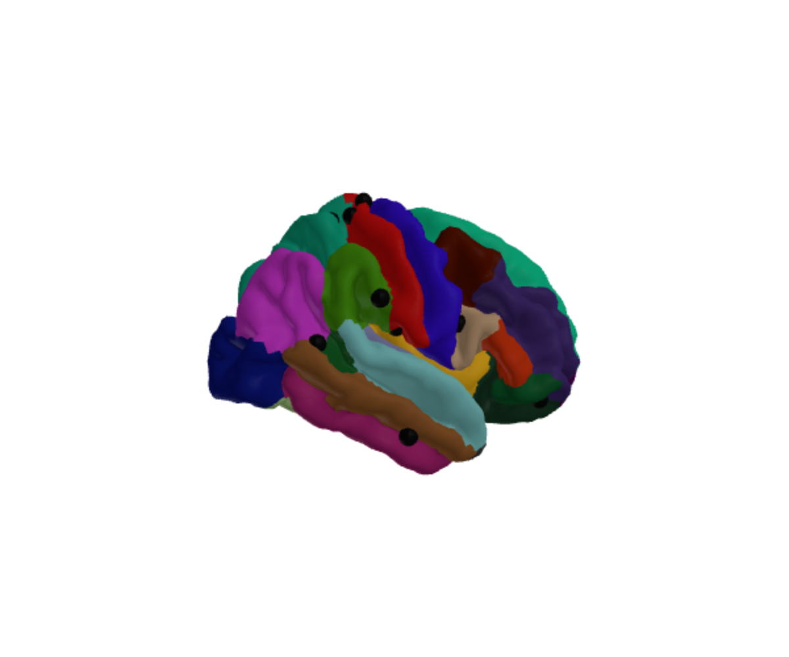
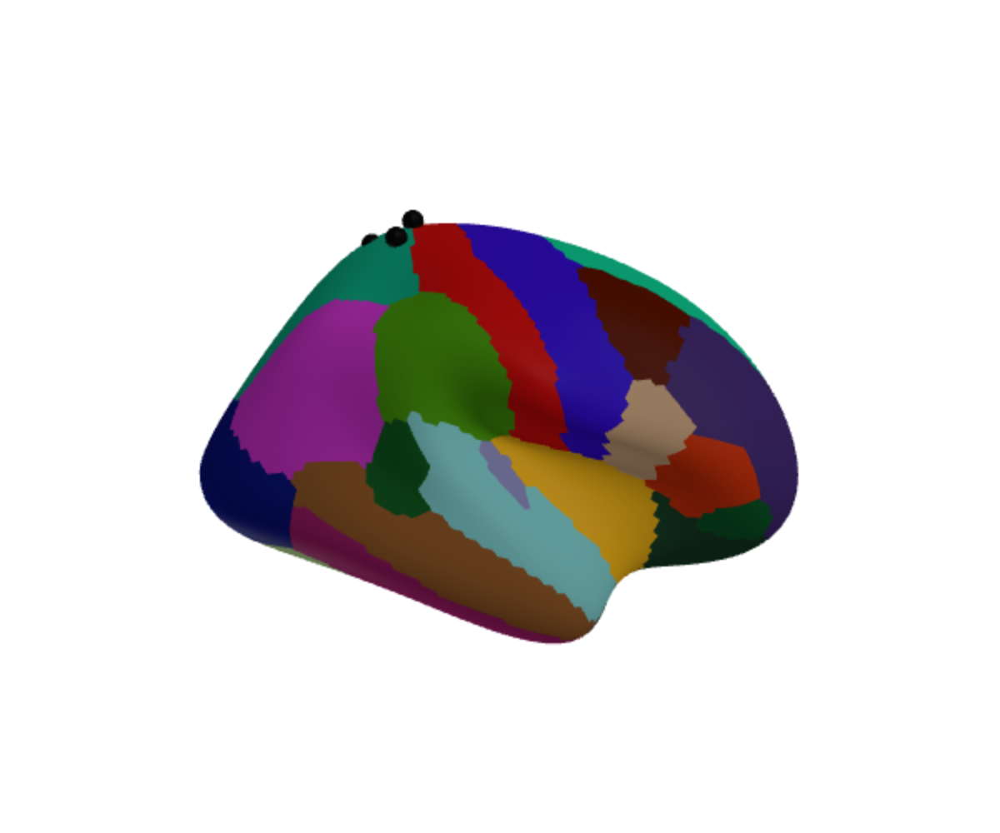
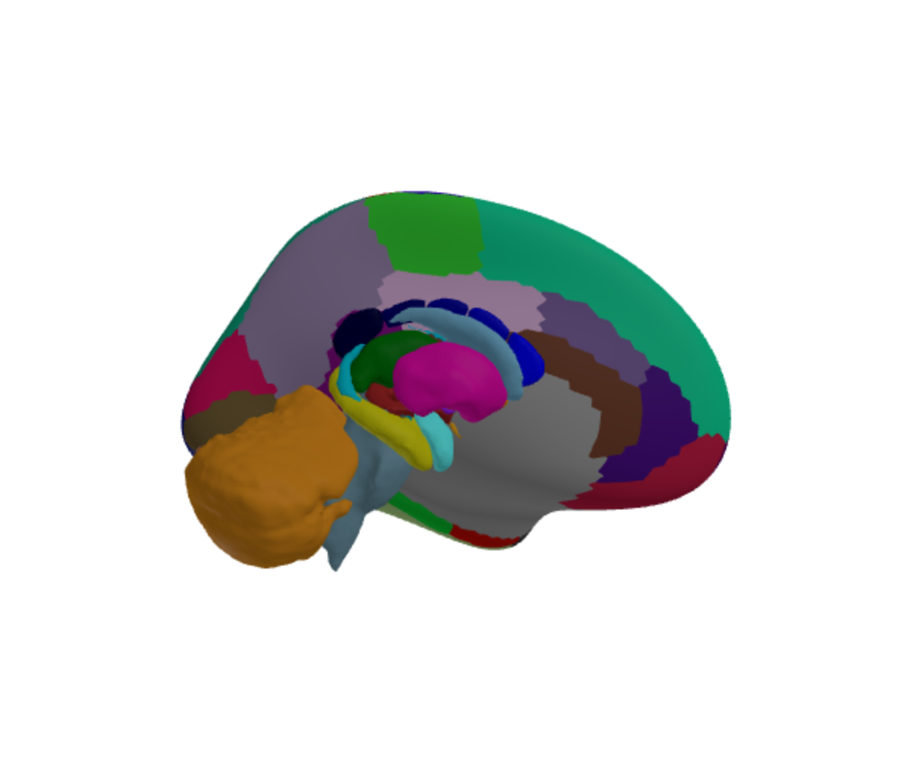
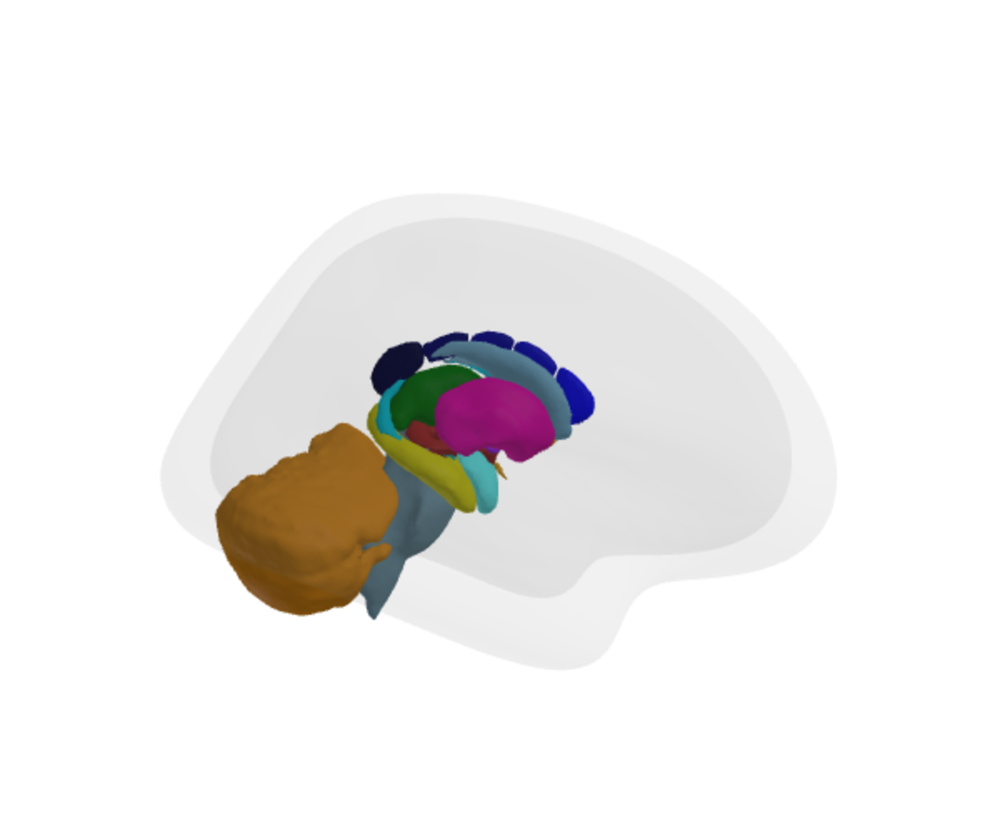

```{r}
#| label: pp-setup
#| include: false
knitr::opts_chunk$set(message = FALSE)
library(ggseg3d)
```

Sooner or later you want something on the brain that is not a parcellation: electrode positions, a stimulation target, the peak of a cluster.
`add_points()` draws those, and `add_atlas()` puts a second atlas in the same scene.

The drawing is the easy part.
The part worth reading about is **which coordinates to give them**, because a plausible-looking number in the wrong space produces a plausible-looking picture that is wrong.

## Points need a surface that means something

Every ggseg3d cortical surface is fsaverage5, but they are not interchangeable.
`"white"` and `"pial"` keep the brain's own shape.
`"inflated"` — what `ggseg3d()` draws by default — has had every vertex moved outward to smooth the folds away.

Here is the same set of coordinates on both.
They were taken straight off the pial surface, so they sit exactly on it:

```{r}
#| label: pp-pial
#| eval: false
pial <- resolve_brain_mesh("rh", "pial")$vertices
set.seed(7)
pts <- pial[sample(nrow(pial), 14), ]

ggseg3d(atlas = dk(), hemisphere = "right", surface = "pial") |>
  add_points(pts, x = x, y = y, z = z, colour = "#111111", size = 4) |>
  pan_camera("right lateral")
```



Change nothing but the surface and most of them disappear inside the brain:

```{r}
#| label: pp-inflated
#| eval: false
ggseg3d(atlas = dk(), hemisphere = "right", surface = "inflated") |>
  add_points(pts, x = x, y = y, z = z, colour = "#111111", size = 4) |>
  pan_camera("right lateral")
```



Nothing went wrong in either plot.
The inflated surface is simply a different shape, so a position on the real brain is not a position on it.
**Plot measured coordinates on `"pial"` or `"white"`.**

## Getting coordinates from a standard space

If your positions come from somewhere else — a montage file, a coordinate table, a paper — they are probably in MNI.
`mni_to_mesh()` converts them:

```{r}
#| label: pp-convert
mni_to_mesh(-42, -20, 55, hemisphere = "lh")
```

The shift is small because the surfaces nearly *are* MNI already.
fsaverage is an MNI305 average, so its coordinates are MNI305; the only difference is that each hemisphere is nudged sideways so the two meet at `x = 0` and can be drawn together.
`mesh_to_mni()` undoes that.

Pass `space = "mni152"` if your coordinates are MNI152 rather than MNI305.
Across the brain that is worth two to three millimetres:

```{r}
#| label: pp-spaces
rbind(
  mni305 = mni_to_mesh(-42, -20, 55, hemisphere = "lh"),
  mni152 = mni_to_mesh(-42, -20, 55, hemisphere = "lh", space = "mni152")
)
```

Asking for an inflated surface is an error rather than a number, because there is no honest answer:

```{r}
#| label: pp-refuse
#| error: true
mesh_to_mni(-42, -20, 55, hemisphere = "lh", surface = "inflated")
```

### A worked example

Three motor-cortex coordinates:

```{r}
#| label: pp-worked-coords
targets <- data.frame(
  label = c("M1 hand", "M1 face", "SMA"),
  x = c(-38, -52, -4),
  y = c(-22, -8, -4),
  z = c(56, 34, 58)
)

placed <- mni_to_mesh(targets$x, targets$y, targets$z, hemisphere = "lh")
placed$label <- targets$label
placed
```

Draw those directly and you will see nothing at all, which is worth
understanding rather than working around.
A coordinate reported as a peak is a point in grey matter, a millimetre or two
*beneath* the surface — so the marker is there, with the cortex in front of it.
That is the opposite of the earlier failure: these are in exactly the right
place, and still invisible.

Either make the marker big enough to break the surface, or put it on the
surface. Projecting to the nearest vertex is a few lines and keeps the
position honest:

```{r}
#| label: pp-project
pial <- resolve_brain_mesh("lh", "pial")$vertices

on_surface <- do.call(rbind, lapply(seq_len(nrow(placed)), function(i) {
  d2 <- (pial$x - placed$x[i])^2 +
    (pial$y - placed$y[i])^2 +
    (pial$z - placed$z[i])^2
  pial[which.min(d2), ]
}))
on_surface$label <- placed$label
```

This one is live: drag to rotate, and hover a marker for its name.

```{r}
#| label: pp-worked
ggseg3d(atlas = dk(), hemisphere = "left", surface = "pial") |>
  add_points(on_surface, x = x, y = y, z = z, text = label,
             colour = "#D7191C", size = 4) |>
  pan_camera("left lateral")
```

`colour` and `size` take one value or one per row, so a column of values can drive either.

## Two atlases at once

`add_atlas()` draws another atlas into the same scene — subcortical structures inside a cortical surface, say:

```{r}
#| label: pp-atlas
#| eval: false
ggseg3d(atlas = dk(), hemisphere = "left") |>
  add_atlas(aseg()) |>
  pan_camera("right lateral")
```



Or the other way round, with the cortex as a translucent shell:

```{r}
#| label: pp-glass
#| eval: false
ggseg3d(atlas = aseg()) |>
  add_glassbrain(opacity = 0.12) |>
  pan_camera("right lateral")
```



Two things to know.

The atlases are **not registered against each other**.
They line up because the ggsegverse atlases share an anatomical frame, not because `add_atlas()` reconciles them.
If you bring your own atlas from elsewhere, check that it agrees before trusting the overlap.

And the legend describes the atlas the plot was built from, not the one added.
If the second atlas needs a readable legend, build the plot from that one and add the other.

## Why the cerebellum sticks out

In the picture above the cerebellum extends past the glass brain.
That is anatomically right — the cerebellum is not inside the cerebral cortex — but the default glass brain is the *inflated* surface, which is larger and rounder than any real brain.
For judging whether something sits inside the cortex, use an anatomical shell:

```{r}
#| label: pp-white-shell
#| eval: false
ggseg3d(atlas = aseg()) |>
  add_glassbrain(surface = "white", opacity = 0.15)
```

## In short

- Measured coordinates belong on `"pial"` or `"white"`, never `"inflated"`.
- `mni_to_mesh()` gets you there from MNI305 or MNI152.
- A peak coordinate sits *inside* the cortex; project it to the surface, or
  enlarge the marker, if you expect to see it.
- `add_atlas()` composes atlases that already share a frame; it does not create one.
